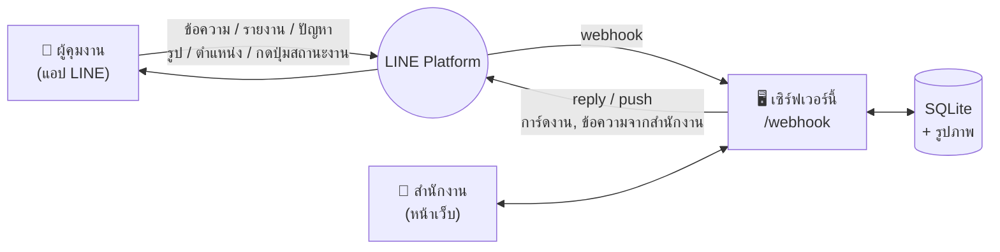

# my-web-app: ระบบประสานงานหน้างานผ่าน LINE

LINE chatbot เป็นคนกลางระหว่าง **ผู้คุมงาน** ที่หน้างานกับ **สำนักงาน** ที่ใช้เว็บแอป
ผู้คุมงานใช้แค่ LINE ส่วนสำนักงานใช้หน้าเว็บ ข้อมูลทั้งหมดเก็บไว้ที่เดียว



## ผู้คุมงานทำอะไรได้ใน LINE

| ทำอะไร | วิธีใช้ |
|---|---|
| ดูงานที่ได้รับมอบหมาย | พิมพ์ `งานของฉัน` → ได้การ์ดงานแบบปัดซ้าย-ขวา |
| อัปเดตสถานะงาน | กดปุ่ม **▶️ เริ่มงาน** / **✅ เสร็จแล้ว** บนการ์ด |
| ส่งรูปผูกกับงาน | กด **📷 ส่งรูปงานนี้** แล้วส่งรูปภายใน 30 นาที |
| ส่งรายงานประจำวัน | `รายงาน เทพื้นชั้น 2 เสร็จ 80% คนงาน 12 คน` (หรือพิมพ์ `รายงาน` แล้วค่อยพิมพ์รายละเอียด) |
| แจ้งปัญหาด่วน | `แจ้งปัญหา ปูนมาส่งไม่ครบ` → ขึ้นเป็นปัญหาค้างบนหน้าแรกของสำนักงาน |
| ส่งรูป / ตำแหน่ง | ส่งตามปกติในแชท ระบบบันทึกให้อัตโนมัติ |
| คุยกับสำนักงาน | พิมพ์ข้อความอะไรก็ได้ |
| ดูเมนู / ยกเลิก | `เมนู`, `ยกเลิก` |

ทุกข้อความมีปุ่มลัด (quick reply) ให้กด ไม่ต้องจำคำสั่ง

## สำนักงานทำอะไรได้บนเว็บ

- **ภาพรวม:** งานค้าง งานเลยกำหนด ปัญหาที่ยังไม่ปิด ผู้คุมงานรออนุมัติ และความเคลื่อนไหวล่าสุด
- **ข้อความ:** แชทกับผู้คุมงานแต่ละคน เห็นรายงาน รูป ตำแหน่ง และการอัปเดตงานในไทม์ไลน์เดียว พิมพ์ตอบแล้วส่งเข้า LINE ของผู้คุมงาน
- **งาน:** มอบหมายงาน (ส่งการ์ดงานเข้า LINE ทันที) เปลี่ยนสถานะ เปลี่ยนผู้รับผิดชอบ และกรองงานเลยกำหนด
- **ผู้คุมงาน:** คนที่เพิ่มเพื่อนบอทจะขึ้นเป็น "รออนุมัติ" กดอนุมัติแล้วบอทจะแจ้งเขาทาง LINE แก้ชื่อ เบอร์ และหน้างานประจำได้

หน้าเว็บรีเฟรชข้อมูลเองทุก 8 วินาที และใช้บนมือถือได้

## ลองรันในเครื่อง (ยังไม่ต้องมี LINE)

ต้องมี Node.js 22.13 ขึ้นไป

```bash
npm install
npm run seed:demo   # ใส่ข้อมูลตัวอย่าง (ไม่บังคับ)
npm start           # เปิด http://localhost:3000
npm test            # รันเทสต์
```

ถ้ายังไม่ได้ตั้งค่า LINE ระบบจะอยู่ใน **โหมดทดลอง** หน้าเว็บใช้ได้ครบ แต่ข้อความจะยังไม่ถูกส่งไป LINE จริง
มีแถบสีเหลืองแจ้งไว้บนหน้าเว็บ

## เชื่อมกับ LINE (ทีละขั้น)

1. **สร้าง LINE Official Account** ที่ [LINE Official Account Manager](https://manager.line.biz/)
2. ใน OA Manager ไปที่ **ตั้งค่า → Messaging API → เปิดใช้งาน Messaging API** (ระบบจะสร้าง channel ใน LINE Developers ให้)
3. เข้า [LINE Developers Console](https://developers.line.biz/console/) แล้วเลือก channel นั้น
   - แท็บ **Basic settings** → คัดลอก **Channel secret** ไปใส่ `LINE_CHANNEL_SECRET`
   - แท็บ **Messaging API** → กด Issue **Channel access token (long-lived)** ไปใส่ `LINE_CHANNEL_ACCESS_TOKEN`
4. คัดลอก `.env.example` เป็น `.env` แล้วใส่ค่าด้านบน รวมถึง `ADMIN_PASSWORD`
5. ขึ้นระบบให้มี HTTPS (ดูหัวข้อถัดไป) แล้วตั้งค่าในแท็บ **Messaging API**
   - **Webhook URL** = `https://<โดเมนของคุณ>/webhook` → กด **Verify** ต้องขึ้น Success
   - เปิด **Use webhook**
6. กลับไปที่ OA Manager → **ตั้งค่าการตอบกลับ**: ปิด *ข้อความตอบกลับอัตโนมัติ* และ *ข้อความทักทาย* (บอทจะทักเอง) แต่เปิด *Webhook* ไว้
7. (แนะนำ) สร้าง **Rich menu** ใน OA Manager เป็นปุ่มแบบ "ข้อความ" เช่น `งานของฉัน`, `รายงาน`, `แจ้งปัญหา`, `เมนู` เพื่อให้ผู้คุมงานกดได้จากเมนูด้านล่างแชท
8. ส่ง QR code หรือลิงก์เพิ่มเพื่อนของ LINE OA ให้ผู้คุมงาน แล้วกดอนุมัติในหน้าเว็บ

**ทดสอบ webhook จากเครื่องตัวเอง:** เปิด tunnel เช่น `npx cloudflared tunnel --url http://localhost:3000` หรือ `ngrok http 3000`
แล้วใช้ URL ที่ได้ตามด้วย `/webhook`

> **เรื่องโควตาข้อความ:** การ *ตอบกลับ* ผู้คุมงาน (reply) ฟรีและไม่นับโควตา
> แต่ข้อความที่ระบบ *ส่งเอง* (push) เช่น การ์ดงานใหม่ การแจ้งอนุมัติ และข้อความที่สำนักงานพิมพ์จากเว็บ จะนับโควตารายเดือนของแพ็กเกจ LINE OA
> ดูจำนวนที่เหลือได้ใน OA Manager ถ้าโควตาหมด ระบบยังบันทึกข้อความไว้และขึ้นเตือน ⚠️ ในแชท

## ขึ้นระบบจริง

ใช้ได้กับโฮสต์ที่รัน Node.js หรือ Docker และมี **ดิสก์ถาวร** สำหรับฐานข้อมูลและรูป เช่น Railway (Volume), Render (Persistent Disk), Fly.io (Volume) หรือ VPS

```bash
docker build -t site-line-bot .
docker run -p 3000:3000 -v $(pwd)/data:/data \
  -e LINE_CHANNEL_SECRET=... -e LINE_CHANNEL_ACCESS_TOKEN=... \
  -e ADMIN_PASSWORD=... site-line-bot
```

เมื่อ `NODE_ENV=production` ระบบจะไม่ยอมเริ่มทำงานถ้าไม่ได้ตั้ง `ADMIN_PASSWORD` (หน้าเว็บถูกล็อกด้วยชื่อผู้ใช้/รหัสผ่าน ยกเว้น `/webhook` ซึ่งตรวจลายเซ็นของ LINE แทน)

## ค่าตั้ง (environment variables)

| ตัวแปร | ความหมาย | ค่าเริ่มต้น |
|---|---|---|
| `LINE_CHANNEL_SECRET` | ใช้ตรวจว่า webhook มาจาก LINE จริง | ไม่มี (webhook ปิดอยู่) |
| `LINE_CHANNEL_ACCESS_TOKEN` | ใช้ส่งข้อความ ดึงโปรไฟล์ และดาวน์โหลดรูป | ไม่มี (โหมดทดลอง) |
| `ADMIN_USER` / `ADMIN_PASSWORD` | ล็อกอินหน้าเว็บสำนักงาน | `admin` / ไม่มี |
| `DATA_DIR` | ที่เก็บ `app.db` และ `uploads/` | `./data` |
| `AUTO_APPROVE` | `true` = ใครเพิ่มเพื่อนก็ใช้งานได้ทันที | `false` |
| `PORT` | พอร์ตเว็บ | `3000` |

## โครงสร้างโค้ด

```
src/
  server.js    จุดเริ่มโปรแกรม
  app.js       Express: /webhook, ล็อกอิน, API, ไฟล์หน้าเว็บ
  bot.js       ตรรกะบอท (รับ event จาก LINE → บันทึก → ตอบ)
  messages.js  ถ้อยคำและการ์ด (Flex Message) ทั้งหมดที่บอทส่ง แก้คำพูดที่ไฟล์นี้
  line.js      เรียก LINE Messaging API + ตรวจลายเซ็น webhook
  api.js       REST API ของหน้าเว็บ
  db.js        ฐานข้อมูล SQLite (ผู้คุมงาน, งาน, ข้อความ)
public/        หน้าเว็บสำนักงาน (HTML/CSS/JS ล้วน ไม่ต้อง build)
scripts/       สคริปต์ใส่ข้อมูลตัวอย่าง
test/          เทสต์ (node --test)
```

## ข้อจำกัดตอนนี้ / สิ่งที่ทำต่อได้

- รองรับแชท 1:1 กับบอทเท่านั้น ยังไม่รองรับกลุ่ม LINE
- สำนักงานมีบัญชีเข้าเว็บบัญชีเดียว (ยังไม่แยกผู้ใช้/สิทธิ์)
- หน้าเว็บอัปเดตด้วยการดึงข้อมูลทุก 8 วินาที (ยังไม่ใช่ real-time)
- รูปเก็บบนดิสก์ของเซิร์ฟเวอร์ ถ้าข้อมูลเยอะควรย้ายไป cloud storage
- ไอเดียถัดไป: สรุปงานส่งเข้า LINE ทุกเช้า, เตือนงานใกล้ครบกำหนด, รายงานประจำวันแบบฟอร์ม (LIFF), export รายงานเป็น Excel/PDF
